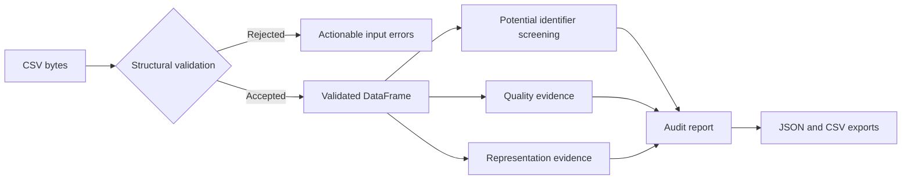
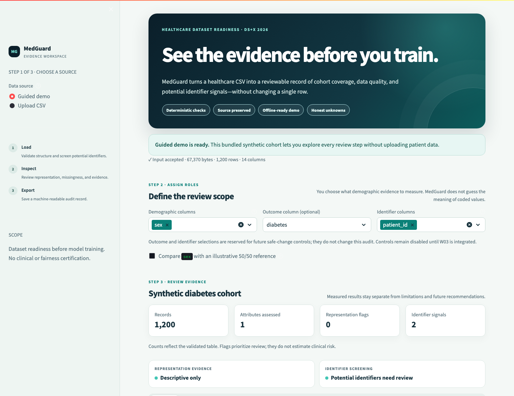

# MedGuard

**Evidence-first dataset readiness for healthcare machine learning.**

MedGuard reviews a healthcare CSV before model training. It validates file structure, screens for potential identifiers, measures missingness and duplicate rows, summarizes explicitly selected demographic columns, and exports the evidence as JSON or CSV.

The application reports what it measured and where evidence is missing. It does not label a dataset fair, certify de-identification, infer patient harm, or claim that a transformation improves model accuracy.

## Working release

The current Streamlit workspace provides:

- A one-click synthetic demonstration with no network or model dependency.
- UTF-8 CSV validation bounded to 25 MB, 200,000 rows, and 500 columns.
- Heuristic screening for potential identifiers with explicit scan coverage.
- User-selected representation summaries with counts, missingness, proportions, and optional reference comparisons.
- Descriptive data-quality counts for missing cells and duplicated rows.
- Strict JSON and reviewable CSV exports.
- Source-preserving analysis. Audit services verify that the input table was not changed.

Potential identifier screening is a review aid. A result with no matched patterns does not establish HIPAA de-identification.

## Run locally

MedGuard is tested with Python 3.11.

```bash
git clone https://github.com/shivamsinghlive/the_medguard.git
cd the_medguard

python3.11 -m venv .venv
source .venv/bin/activate
pip install -r requirements.txt

streamlit run src/ui/audit_workspace.py
```

Open `http://localhost:8501`. The guided demo is selected by default and does not require Ollama, an API key, or an internet connection.

Run the deterministic test suite:

```bash
python -m pytest -q
```

## Review flow



The same DataFrame returned by validation feeds every downstream check. Uploaded files are not independently re-parsed after validation.

## What the statuses mean

| Status | Meaning |
|---|---|
| `review_needed` | A documented rule identified evidence that needs human review. |
| `descriptive_only` | Measurements are available, but no review rule was triggered. |
| `insufficient_evidence` | The selected data cannot support the requested measurement. |
| `no_patterns_found` | Identifier screening found none of its listed patterns in the reported coverage. This is not privacy clearance. |

Priority labels organize review order. They are not estimates of clinical risk.

## Repository map

```text
data/synthetic/                 Bundled demonstration datasets
src/services/contracts.py       Shared JSON-safe result contract
src/services/input_validation.py
src/services/privacy_screening.py
src/services/representation.py  Deterministic analysis services
src/services/audit_runner.py    Report orchestration and exports
src/ui/audit_workspace.py       Active Streamlit experience
tests/analysis/                 Service-level edge cases
tests/integration/              End-to-end evidence packaging
tests/ui/                       Streamlit behavior regressions
docs/demo/                      Hackathon demo materials
```

Legacy experimental agents and utilities remain in the repository for evaluation. They are not part of the active audit path.

## Demonstration

Use the bundled diabetes cohort for the shortest offline walkthrough:

1. Keep **Guided demo** selected.
2. Confirm `sex` is the demographic column.
3. Inspect the observed 73/27 representation without enabling a reference.
4. Enable the illustrative 50/50 reference and observe that the gap remains descriptive rather than becoming an automatic fairness verdict.
5. Open **Identifier screening** to review coverage and limitations.
6. Download the JSON audit record.

The full presenter script and judge questions are in [`docs/demo/DEMO_SCRIPT.md`](docs/demo/DEMO_SCRIPT.md) and [`docs/demo/JUDGE_QA.md`](docs/demo/JUDGE_QA.md).



## Current boundaries

MedGuard currently does not:

- Measure model performance without labels, held-out predictions, and an evaluation protocol.
- Determine clinical harm from demographic representation.
- Certify fairness, safety, regulatory compliance, or de-identification.
- Upload data to an AI provider in the active workflow.
- Automatically balance cohorts or apply SMOTE.
- Modify the source dataset.

Safe, explicit change previews are being developed separately and will require user review before export.

## Team workflow

Shivam owns product UI, integration, and demonstration materials. Swathi owns deterministic analysis, validation, safe-change previews, and release validation. Each task is developed on an isolated branch and merged through a pull request.
